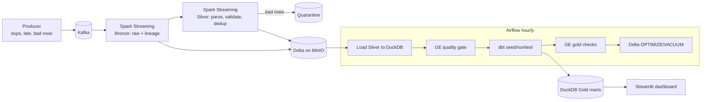

# Ride Lakehouse: streaming + batch lakehouse for ride analytics

An end-to-end data platform that replays NYC TLC taxi trips as a live event stream, lands them in a
medallion lakehouse, models them with dbt, orchestrates the batch layer with Airflow, and gates every
stage with data-quality checks. The whole thing runs locally with one command and no cloud bill.



**Stack:** Python, Kafka (KRaft), Spark Structured Streaming, Delta Lake, MinIO (S3 API), Airflow, dbt-duckdb,
Great Expectations, Streamlit, Docker Compose, GitHub Actions.

## Quick start

```bash
make data      # downloads one month of TLC trips + the zone lookup (dbt seed)
make up        # builds and starts everything (first build downloads Spark jars: a few minutes)
make produce   # replays 200k trips into Kafka (~3-4 min); tune with ARGS="--max-rows 50000 --rate 2000"
make logs-silver   # watch micro-batches: valid / rejected / reject_rate
```
Then open Airflow at http://localhost:8080 (admin/admin) and trigger `gold_refresh`.
Dashboard: http://localhost:8501. MinIO console: http://localhost:9001 (minioadmin/minioadmin).
`make test` runs unit tests, `make reset` wipes all state.

## Layers

| Layer | Where | What happens |
|---|---|---|
| Bronze | `streaming/bronze_job.py` | Kafka to Delta, payload stored raw plus partition/offset/timestamps. No cleaning, so the stream can always be replayed. |
| Silver | `streaming/silver_job.py`, `transforms.py` | Typed parse, validation rules, watermark + dedup on `(event_id, pickup_ts)`. Rejects go to a **quarantine** table with a `reject_reason`. |
| Gold | `dbt_project/` | `fct_trips`, `dim_zone`, `dim_date`, `agg_demand_by_zone_hour` (incremental), `agg_daily_revenue`. 16 dbt tests. |
| Quality | `quality/run_checks.py` | Great Expectations gates on Silver and Gold plus a reject-rate threshold. A failure stops the DAG before bad data is published. |

## Design decisions and trade-offs

- **Bronze stays raw.** Parsing bugs are fixed by replaying Bronze, never by re-pulling from the source.
- **Quarantine instead of dropping.** Every rejected row is kept with a reason, so reject rate is measurable and fixable.
- **Dedup with a watermark.** State is bounded: keys older than the 30-minute watermark are evicted. Duplicates arriving later than that slip through; a periodic MERGE-based dedup would catch those.
- **Idempotent writes.** Silver uses Delta `txnAppId/txnVersion`, so a retried micro-batch cannot double-write.
- **Incremental Gold with a look-back.** Late trips re-open recent hours, so the model recomputes the last 3 hours (`delete+insert` on a unique key) instead of only appending newer rows.
- **Quality gate before publish.** Silver checks run before dbt; dbt tests and Gold checks run after.
- **DuckDB as the serving warehouse.** A small loader step publishes Silver into DuckDB, which keeps dbt simple and portable. See "At scale".
- **Isolated tool environments.** dbt, delta-rs and Great Expectations live in their own venv inside the Airflow image to avoid dependency conflicts with Airflow's pins.

## Testing and CI

`.github/workflows/ci.yml` runs ruff, pytest (transform logic on a local SparkSession, producer logic), `docker compose config`,
and a full `dbt seed/run/test` against a synthetic Silver table.

## At scale (what I would change)

- Kafka: more partitions keyed by a business key; Schema Registry with Avro and compatibility checks.
- Storage: partition by date, scheduled compaction and Z-ORDER; consider Iceberg for multi-engine access.
- Compute: Spark on EMR/Databricks/K8s with autoscaling; a lock-safe S3 log store (DynamoDB) for concurrent writers.
- Warehouse: replace the DuckDB load with a warehouse that reads Delta natively (Databricks SQL, Trino, Athena).
- Ops: Terraform for infra, OpenLineage for lineage, alerts on reject rate and consumer lag.

## Known limitations

- Single-node, local mode: it demonstrates the design, not throughput.
- The producer replays one file in time order; the delay for "late" events is configurable (`--late-delay`).
- Unparseable JSON payloads are not routed to quarantine yet (a good first extension).
- Delta maintenance uses delta-rs with `AWS_S3_ALLOW_UNSAFE_RENAME`, which is only safe for single-writer demos.
